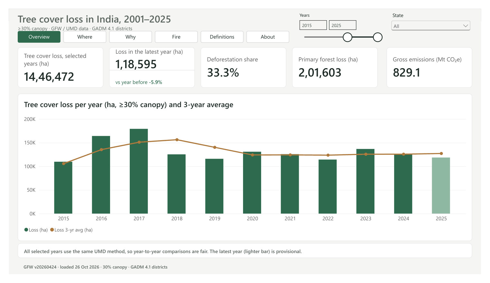

# Canopy Ledger: tree cover loss in India, 2001–2025

Where is India losing tree cover, why, and is it getting worse? This project answers that from the published
University of Maryland / Global Forest Watch (GFW) data: a tested PostgreSQL + dbt warehouse, a Power BI report,
and a monthly refresh. India lost 2.43 Mha of tree cover in 2001–2025, mostly in the
Northeast, and mostly to shifting cultivation rather than deforestation.



## Findings

1. **Scale.** 2.43 Mha lost in 2001–2025; 2.31 Mha for 2001–2024, matching GFW's published figure.
2. **Trend.** 2021–2025 averaged 124 kha a year, 13% below 2016–2020 (143 kha). Loss peaked in 2017 (179 kha).
3. **Concentration.** 17 of 415 districts with loss account for half of all loss since 2015; 16 are in the Northeast, which holds 74% of national loss.
4. **Drivers.** Shifting cultivation is 60% of loss (73% in the Northeast). Only about 40% falls in classes that count as deforestation.
5. **Fire.** High-confidence fire alerts peak in March, but fire is only 1.6% of lost hectares, and alert counts are a weak guide to it.
6. **Definitions.** The India State of Forest Report shows rising forest cover while GFW shows continuous loss. They measure different things (net stock including plantations vs gross canopy removal), so both are true.

## The dashboards

- Power BI: `powerbi/canopy-ledger.pdf` (pages) and `powerbi/measures.dax` (every measure).

## How it works

```
GFW Data API -> raw CSV + manifest -> checks -> PostgreSQL (raw) -> dbt (staging -> marts) -> Power BI
```

Each step is one `ledger` subcommand. The same commands run by hand, in CI and in the monthly refresh.

## Data and caveats

- Sources are pinned in `configs/sources.toml`: tree cover loss and extent `v20260424`, VIIRS alerts `v20251202`, GADM boundaries `v4.1`.
- One canopy threshold (30%) is analysed. Every hectare of loss is listed once per threshold it clears, so summing all thresholds overstates loss several times over.
- Tree cover loss is not deforestation. Method changes in 2011 and 2015 mean comparisons should stay within an era.
- 2025 is provisional until the next GFW release. "District" means a GADM 4.1 district (634), not today's list.
- Full contract: top of `docs/data_dictionary.md`.

## Exploration

[Data dictionary](docs/data_dictionary.md) · [Profiles](docs/profiles/) · [EDA memo](docs/eda_memo.md) · [Decision log](docs/decisions.md) · [Runbook](docs/runbook.md) · notebooks in `notebooks/`.

## Run it yourself

```bash
cp .env.example .env            # add your GFW_API_KEY
docker compose up -d            # local PostgreSQL on port 5435
pip install -e ".[explore,warehouse,dev]"
ledger extract && ledger checks && ledger load
dbt build --project-dir warehouse --profiles-dir warehouse
```

To run against a hosted database (Neon), point `DATABASE_URL` and the `PG*` variables in `.env` at it.
`ledger fixtures` writes synthetic data so the whole pipeline runs without a GFW key.

## Tests and CI

- `pytest`: API client, frame cleaning, EDA functions and the raw data checks, on synthetic fixtures.
- dbt: 28 data tests (uniqueness, not-null, relationships, and reconciliation of the fact table to staging).
- CI (`.github/workflows/ci.yml`) runs lint, pytest and the full fixtures -> checks -> load -> dbt pipeline on every push.
- The monthly refresh (`.github/workflows/refresh.yml`) pulls, checks, loads and rebuilds the hosted warehouse.
